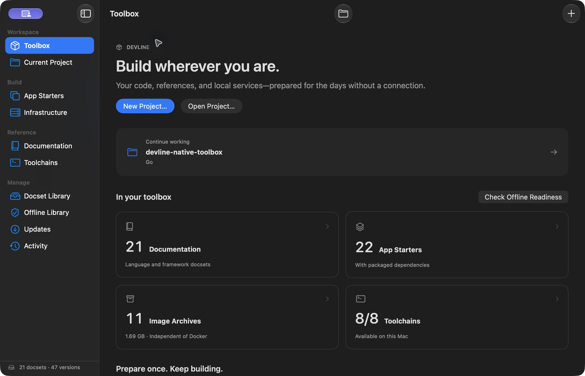
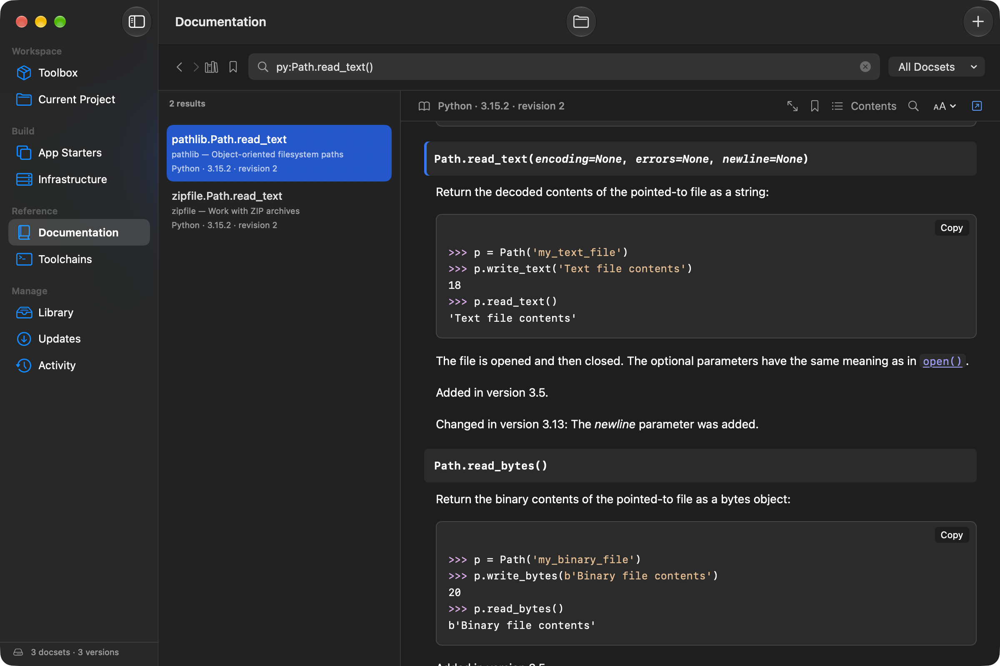
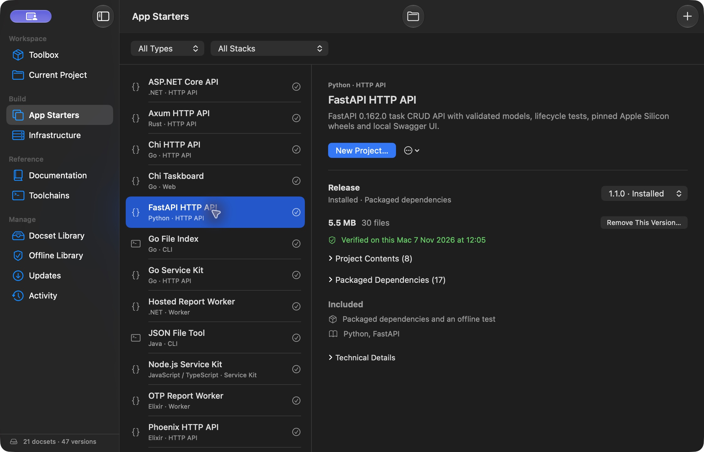
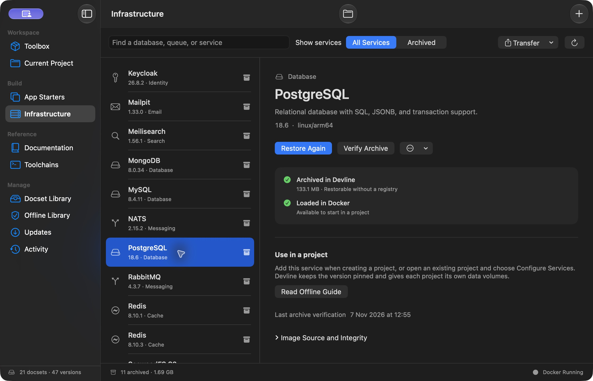

# Devline

Devline is a Mac app and CLI for trying frameworks and building small proofs of concept offline. It keeps documentation, project starters with their dependencies, and local service images on your Mac.

Choose what you want to use while you’re connected, then create projects, read the docs, and run local services without internet access. The app and terminal share the same library.

Open a project and Devline brings its dependencies, matching references, and service images together. **Prepare Offline** fills the missing pieces and checks the result. Recent projects on the Toolbox take you back to where you were working.



## Keep the docs you use

Install documentation for the languages and frameworks you want from **Library**. Then look up `py:Path.read_text()` or `go:http.Handler` in **Documentation**, with code examples and links to other installed pages. **Browse Project Docs** takes you to your project's references. Devline reads supported manifests and lockfiles to match versions, and you can pin a different version for that project. A starter's included references open at the version it uses.

For SwiftUI, choose **Prepare from Xcode** in **Library → From This Mac**. Devline indexes Apple’s API declarations, comments, and available examples from your selected SDK. The reference stays on the Mac where you prepare it. Apple’s website tutorials and illustrations are separate. [SwiftUI setup](USAGE.md#prepare-the-swiftui-sdk-reference)



## Start with dependencies included

Pick a release in **App Starters**. For example, start a FastAPI or Chi API, try a React/Vite app, write a Playwright browser test, or build a desktop app with Tauri or SwiftUI. There are starters for Go, Rust, Python, Ruby, C#/.NET, Java, Elixir, Node.js/TypeScript, and Swift. Each includes its package dependencies and an offline test. The SwiftUI starter needs Xcode 16 or later. The bundled Playwright browser requires macOS 26.5 or later.

**Toolchains** shows which compilers, interpreters, and SDKs Devline finds on this Mac. Install the matching toolchain and any listed native build prerequisites separately. When you create a project, Devline runs its tests with external networking denied before saving it to your chosen folder. In **Current Project**, you can prepare and verify supported existing projects while keeping their source and lockfiles intact.

Projects from bundled starters group Devline's configuration, scripts, and offline files under `.devline/`. Run `./devline.sh --help` for the available commands or `./devline.sh test` to run the starter's tests. Framework files such as `go.mod` and `package.json` stay beside your code so their usual tools can find them.



## Bring the services your project needs

While connected, use **Infrastructure** to archive services such as PostgreSQL, Redis, RabbitMQ, or an S3-compatible store. With a local Docker engine running and Compose installed, Devline can restore those exact images from its vault and start them on local ports without pulling them again. For example, the Chi Taskboard starter uses PostgreSQL for storage and Redis for caching. Stop the services from **Current Project** and the data volumes stay on disk.

Choose **Read Offline Reference** on a service to open its publisher documentation. **Offline Reference Coverage** lists the included material and any gaps. [Infrastructure documentation](USAGE.md#devline-help-and-reference-coverage)

When adding a service, you can also choose its recommended client library for your project’s language. The choice is optional. Devline adds the selected packages, saves their dependencies locally, and checks the build before applying the change.

Before going offline, use **Prepare Offline** in **Current Project** to prepare its docs, dependencies, and pinned image archives together. The result shows anything still needed, such as a missing toolchain or a stopped Docker engine. **Updates** checks the content sources together and can prepare newer releases without changing your project's pins. You can also export portable docsets, starters, and image archives to take to another compatible Mac.



## Install

On an Apple Silicon Mac with macOS 14 or later, open the DMG and drag **Devline** into **Applications**. Use the DMG for upgrades to 0.7.0 as well. It includes first-launch instructions for the ad hoc-signed build, which ships without Apple notarization. [Download Devline 0.7.0](https://github.com/fpl0/devline/releases/download/v0.7.0/Devline-macos-arm64.dmg)

## Do the same work from the terminal

In **Settings → Command Line**, select **Install CLI**. To try the Chi API, first prepare the starter and its docs. The next two commands work offline with the matching Go toolchain installed.

```sh
devline prepare go/chi-api@1.2.0
devline --offline docs show 'go:http.Handler'
devline --offline new go/chi-api@1.2.0 ./status-api
cd ./status-api
./devline.sh test
```

For an existing project, `devline project --path ./service prepare` prepares its complete offline environment. Use `devline updates check` and `devline updates apply` to keep the installed content current.

The [usage guide](USAGE.md) has the CLI commands for project preparation, services, updates, library transfer, and building from source. [Validation and coverage](UX-VALIDATION.md) · [Core protocol](CONTRACT.md) · [Third-party notices](THIRD_PARTY_NOTICES.md)
