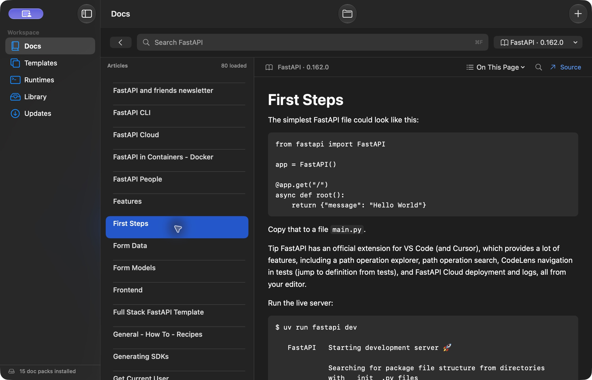

# Devline

Devline is a native macOS app and terminal tool for searching installed developer documentation and creating projects from versioned starters. The desktop app and CLI use the same local library.



## Download

Download the Apple Silicon installer from [GitHub Releases](https://github.com/fpl0/devline/releases/latest). Open the DMG, drag **Devline** into **Applications**, then open it. macOS 14 or later is required. This first release uses ad hoc signing and includes Apple’s first-launch guidance. A future Developer ID-signed, notarized build can use the standard Gatekeeper installation flow.

## Open the app

After installing from the DMG, open **Devline** from **Applications**. If you downloaded the ZIP, extract it and move `Devline.app` into **Applications** first.

1. Open **Library** and select the doc packs and starter releases you want. **Install Selected** copies from the catalog bundled in the app. Each installed doc pack becomes searchable in **Docs**.
2. Use **⌘F** to find an API, symbol, or topic. Filter by stack or doc-pack version. Use **⌘O** to open a project folder and detect its stack from its files. **⌥⌘F** finds text in the open reference. **Official Source** opens the publisher’s site in your browser.
3. Open **Runtimes** to check detected toolchains, their executable paths and versions, and what setup is needed. **Prepare Starter** installs the verified starter and related docs from the bundled catalog.
4. In **Templates**, select a starter family and choose a release from its version picker. Install it on its own or with the related docs. **New Project** opens a sheet that checks the installed bundle and required toolchain. Choose a project name and an existing parent folder. The completion screen shows where the project was created and how to run its first test.

The bundled doc packs contain selected sections from upstream language and framework references. Each pack records its sources and license. Installing a starter gives you its packaged dependencies. Its compiler, interpreter, or SDK must already be available on your Mac. **Preview** releases are in the catalog for inspection and require offline verification before they can create projects.

The offline reader renders Markdown headings, lists, tables, and code blocks. Some guides were imported with inline links reduced to labels. **Official Source** opens the full upstream page.

## Use the CLI

In the app, open **Devline → Settings → Command Line** and choose **Install CLI** to link the bundled command at `~/.local/bin/devline`. If your shell needs that directory on its `PATH`, use **Copy PATH Command** and run the copied command in Terminal.

If you built and installed from source, you can also add the local launcher to your shell from the repository root.

```sh
export PATH="$(cd ../bin && pwd):$PATH"
devline library
devline runtimes
devline docs install go
devline docs search 'http.Handler' --stack go
devline docs show 'http.Handler' --stack go --no-pager
```

The CLI works with the app closed. Run a doc lookup from inside a project to use its detected stack when available. To open a reference in the desktop app, launch `Devline.app` once to register links, then run `devline docs show 'http.Handler' --stack go --open`.

```sh
devline templates list --stack go
devline prepare go/chi-api@1.1.0
devline doctor go/chi-api@1.1.0
devline new go/chi-api@1.1.0 ./status-api --dry-run
devline new go/chi-api@1.1.0 ./status-api
cd status-api
./devkit-test.sh
```

`prepare` installs the selected starter and its related docs, then reports readiness. If you omit the version, `new` prefers the latest installed, verified release for your Mac’s target and then checks its toolchain. Use `--json` for structured results and `devline completions zsh` for shell completions. `doctor` and `prepare` exit with status 3 when preparation is needed. An empty search exits with status 4.

Search, reads, and creation use local files. A recipe with upstream refresh support can build a new release while connected. For example, `devline templates build go/chi-api --refresh-deps` resolves dependencies and installs the new release after its offline checks pass. Earlier releases stay available.

## Updates

Open **Updates** or choose **Devline → Check for Updates…**. Reading status stays local. **Check for Updates** contacts the official release sources. Cached versions remain available when a later check fails, with the failure shown explicitly. Filter to **Available** to see pending updates.

- Newer bundled documentation and verified starter releases install alongside existing versions.
- The upstream documentation action opens the publisher’s latest documentation. Updated offline snapshots are distributed through catalog releases.
- Template rebuilds resolve current dependencies within the recipe’s supported version range and run offline verification before adding an immutable release.
- Runtime updates open official installation pages so you can use your existing version manager or installer. Devline does not silently replace toolchains.
- App checks use the [public GitHub release manifest](https://github.com/fpl0/devline/releases/latest/download/release.json). An available app update opens the release page. The native settings and CLI can replace or clear this channel.

```sh
devline updates                 # cached status, no network
devline updates check           # explicit online check
devline updates check --json    # structured status for scripts
devline --offline updates      # cached status while disconnected
```

For a custom app release channel, serve `{"schema_version":1,"version":"0.2.0","url":"https://example.com/releases/0.2.0"}` over HTTPS, then run `devline updates configure https://example.com/release.json`. URLs must not include credentials, queries or fragments. `devline updates configure --clear` disables app checks.

The `devkit` command remains a compatibility alias in the app and packaged launchers. Existing `DEVKIT_HOME`, `DEVKIT_CATALOG`, `devkit://` links, and generated project filenames remain supported.

## Build from source

On an Apple Silicon Mac with Xcode and its command-line tools, Rust/Cargo, and Python 3, run these commands from the repository root.

```sh
./scripts/package.sh --no-install
./scripts/create-dmg.sh
./scripts/install.sh
cargo test --locked --manifest-path core/Cargo.toml
```

The package script uses Xcode’s native icon compiler and the checked-in catalog snapshots and may need a connection to fetch Cargo build dependencies. Without `--no-install`, it installs the local build at `~/Applications/Devline.app`, writes `../Devline-macos-arm64.zip`, and creates `../Devline.app` and `../bin/devline` launchers, with `devkit` as a compatibility alias. Bundles are signed in a temporary local directory because iCloud File Provider adds metadata to app folders in Documents.

- `macos/` contains the SwiftUI app and C bridge. Native requests cross the bridge off the UI thread.
- `core/` contains the Rust CLI, SQLite search and local library, template installation, and project creation.
- `data/` contains the versioned docs and starter bundles, upstream source notices, and catalog manifests.
- `scripts/` contains the packaging and documentation preparation tools.

[GitHub Actions](https://github.com/fpl0/devline/actions) checks Rust formatting, tests, and lint, then builds the native app on Apple Silicon. [Core protocol](CONTRACT.md) · [Third-party notices](THIRD_PARTY_NOTICES.md)

The existing library stays at `~/Library/Application Support/DevKit` for compatibility with earlier builds. Set `DEVKIT_HOME` for an isolated library and `DEVKIT_CATALOG` to use a different catalog directory. The CLI also accepts `--home` and `--catalog`.

## Included and verified

The catalog contains 15 documentation packs (9,857 searchable records) and 10 starter releases across Python/FastAPI, C#/ASP.NET Core, Java/Spring Boot, Ruby, Go/Chi, Rust/Axum, and Elixir/Phoenix. The newest Go and Python starters include an in-memory task API with validation, structured errors, and lifecycle tests. The ASP.NET starter includes SQLite.

All ten starter releases passed smoke tests with external network access denied, using fresh language caches or environments and the toolchains installed on this Apple Silicon Mac. Devline detects the compiler or interpreter on the Mac. Generated projects include `devkit-test.sh`, which selects the detected runtime and companions. `DEVKIT_TOOLCHAIN` can override it. Generated projects for all seven stacks also passed with a system-only PATH. The final Rust check rebuilt with empty Cargo caches and external networking blocked.

The core has 25 passing regression tests for indexing, concurrent installs, atomic failures, release selection, corruption checks, symlink rejection, project overwrites, and command quoting. Clippy passed with warnings denied. Native Library installation, search, reading, and project creation were exercised through the actual macOS interface.

A 48-query CLI benchmark of the installed 0.2.0 release over the full library measured 19.07 ms median and 50.74 ms at the 95th percentile on this Mac with warm filesystem caches. This includes process startup. It is a local measurement, not a performance guarantee on other hardware.

Go's online dependency refresh, network-denied verification, and new-release publication were exercised end to end. Refresh recipes for the other stacks are included but have not yet been exercised end to end against their upstream registries. Normal lookup, installation from the bundled catalog, and project creation stay local.
