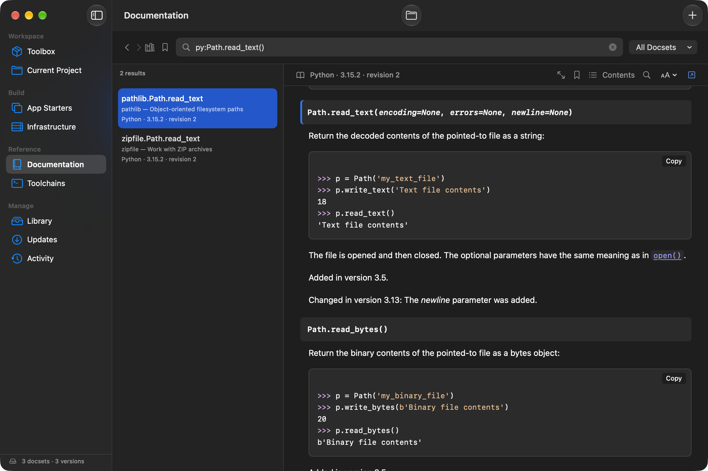
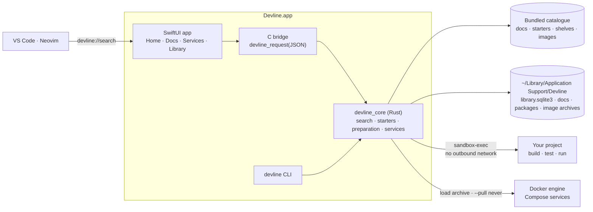

<div align="center">

# Devline

**A macOS app and CLI for trying frameworks and building prototypes offline.**<br>
Documentation, project starters, packages and local services for nine runtimes — prepared while you're online, used on your Mac with no connection at all.

[Download](https://github.com/fpl0/devline/releases/latest) · [Install](#install) · [How it works](#how-it-works) · [Usage guide](USAGE.md)

</div>

---

Prepare a project while you're online, then look up APIs, build and test your code, and start local services without a connection. Devline is a native SwiftUI app and a `devline` command that share the same library on your Mac. It carries:

- **23 bundled docsets** — official references for Python, Go, Rust, Java, C# and .NET, Ruby, Elixir, Node.js, TypeScript and Swift, their main frameworks, and ten local services. Devline matches documentation to a project's dependencies and lets you pin an exact release. SwiftUI's reference is prepared from your own Xcode SDK, and you can import DevDocs snapshots too.
- **27 project starters** — three complete applications for each of nine runtimes, from a FastAPI order ledger and a React planning app to a native SwiftUI notes app, each with its dependencies included and offline tests. For an existing project, **Prepare for Offline** collects what's missing and tests a copy with internet access blocked, leaving your source and lockfiles intact.
- **900 packages on a shelf** — 100 popular packages for each runtime, from PyPI, npm, crates.io, Go modules, Maven Central, NuGet, RubyGems, Hex and Swift packages. Add any of them to a project later, and Devline tests the result with the network blocked.
- **10 local services** — PostgreSQL, MySQL, RabbitMQ, Redis, MongoDB, NATS, Mailpit, Meilisearch, SeaweedFS S3 and Keycloak, saved as exact, verified image archives while connected and restored offline into a local Docker engine with Compose. Optional client libraries cover all ten services across the nine runtimes.

It is built to **prove that a project works offline**: every starter check, package addition and project run happens in a macOS sandbox that denies outbound connections except to your own machine, so what passes in Devline needs nothing from the internet.



## Contents

- [Screens](#screens)
- [Install](#install)
- [What's inside](#whats-inside)
- [How it works](#how-it-works)
- [Build and test](#build-and-test)
- [Scripts](#scripts)
- [Project layout](#project-layout)
- [Known limitations](#known-limitations)
- [Credits and licences](#credits-and-licences)

## Screens

| | |
|---|---|
| **Home** | One checklist for the whole Mac — documentation and starters, toolchains, a Docker engine, service images, packages and the terminal command. Each line says what is missing and has the button that fixes it; when every line is checked the heading reads **Ready to work offline**. **New project** lists every starter by runtime, and **Open Folder…** (<kbd>⌘O</kbd>) opens your own code. |
| **Project** | Each open project gets a page: its references matched to detected dependencies (with pins), **Offline readiness**, **Prepare for Offline**, **Add Packages…** and **Add Services**. **Run** starts its services and the app with internet access blocked and shows the output as it arrives; **Open App** appears once a local web app passes its health check. |
| **Docs** | Search installed references with <kbd>⌘F</kbd>, or use a prefix such as `py:Path.read_text()`. <kbd>⇧⌘O</kbd> pins Contents beside the article, <kbd>⇧⌘R</kbd> is Focus Reading, <kbd>⌥⌘F</kbd> finds text in an article, <kbd>⌘[</kbd> and <kbd>⌘]</kbd> move through history, <kbd>⌘D</kbd> saves a reference and <kbd>⇧⌘B</kbd> opens Saved and Recent. **Manage Docs** installs, updates, rolls back and imports from DevDocs. |
| **Services** | The ten services, each release with its image publisher, licence, exact tag, platform digest and offline runbook. **Download for Offline Use** saves a verified arm64 archive independently of Docker's cache. **This Project** shows a project's ports and opens consoles such as Mailpit's inbox and RabbitMQ's management UI; **Transfer** exports and imports image archives. |
| **Library** | **Contents** checks the readiness of docsets, starters and images and exports or imports portable bundles. **Starters** shows each release's contents, dependency versions and verification. **Packages** lists each runtime's shelf. **Toolchains** shows the compilers and SDKs found on this Mac, and how to install the rest. **Updates** checks for newer starters and images. |
| **Activity** | Every background job — creating, preparing, downloading, importing — with progress, logs and cancellation. |

Press <kbd>⌃⌥D</kbd> from any app to look up a symbol, or <kbd>⌃⌥⌘D</kbd> to look up the selected text (with Accessibility access). **Services → Look Up in Devline** works too.

## Install

Devline has two parts: the **app**, which includes the `devline` command and the bundled documentation and starters, and the **offline extras** — packages, service images and toolchains — that you fetch for your Mac while you're connected.

### Requirements

- An Apple silicon Mac running macOS 14 or later
- About 1.5 GB for the download, plus space for the package shelves and service images you choose
- The toolchains for the runtimes you want to use. Devline finds them and never changes them; starter baselines are Python 3.15.2, Go 1.27.3, Rust 1.99.1, Node.js 26, Ruby 4.0.9, Elixir 1.20.5, .NET SDK 10.0.400, Maven 3.10.0 and Swift 6.0 (Xcode 16 or later for the Swift starters)
- For local services only: a Docker engine with Compose, such as Docker Desktop or OrbStack
- For building from source: Xcode and its command-line tools, Rust/Cargo and Python 3

### 1. Get the app

**Download** `Devline-macos-arm64.dmg` from the [latest release](https://github.com/fpl0/devline/releases/latest) (v0.7.0, 1.5 GB; a `.zip` and `SHA256SUMS` are attached too). Open it and drag **Devline** into **Applications**.

The app is ad hoc signed and not notarised by Apple, so macOS blocks the first launch. Open **System Settings → Privacy & Security** and choose **Open Anyway** (see [Apple's guidance](https://support.apple.com/en-us/102445)), or run `xattr -dr com.apple.quarantine /Applications/Devline.app`. The DMG's **Read Me** has the same instructions.

While the app runs, its **d** icon stays in the menu bar, even when you close the window. Choose **Open Devline** to bring the workspace back, or **Quit Devline** to exit.

**Or build it yourself:**

```bash
git clone https://github.com/fpl0/devline.git
cd devline
./scripts/package.sh    # builds ../Devline-macos-arm64.zip and installs ~/Applications/Devline.app
./scripts/create-dmg.sh # optional: wraps that ZIP in ../Devline-macos-arm64.dmg
```

Use `./scripts/package.sh --no-install` to build without installing. Packaging writes its outputs next to the repository folder and adds a `../bin/devline` launcher. The build uses checked-in catalogue snapshots and may download locked Rust dependencies and Sparkle.

### 2. Get ready before you go offline

Do this **now, while you have internet**. Work through the checklist on **Home**:

- **Documentation and starters** come inside the app. **Install** adds all of them to your library in under a minute and needs no connection.
- **Toolchains** — for one that is missing, **How to Install** shows the command for mise or Homebrew, whichever your Mac has. Choose **Rescan** afterwards.
- **Docker** is needed only for projects that use a database, queue or another service. **Setup Guide** lists the engines Devline works with.
- **Service images** — **Download All** saves the images the starters use.
- **Packages** — **Download All** fetches each shelf, with its dependencies, for every toolchain on your Mac.

While your Mac has no connection, the sidebar says so and the download buttons wait.

### 3. Use the terminal

In **Settings → Command Line**, choose **Install CLI** to link the bundled command at `~/.local/bin/devline` (**Copy PATH Command** adds that folder to your shell). With a compatible Go toolchain installed, prepare the Chi starter and its docs, then create and test a small API offline:

```bash
devline prepare go/chi-api@1.2.0
devline --offline docs show 'go:http.Handler'
devline --offline new go/chi-api@1.2.0 ./status-api
devline --offline project --path ./status-api run -- go test ./...
```

Keep packages for later and add them offline:

```bash
devline packages download python
devline --offline packages add --path ./status-api httpx rich
```

The CLI works with the app closed and shares its library. `--offline` requires local resources, `--json` gives structured output, and `devline completions --help` sets up shell completion.

### 4. Import DevDocs (optional)

In **Docs → Manage Docs → Import from DevDocs**, choose a docset and release. After it downloads, find it under **Imported**. You can also import from the CLI:

```bash
devline docs import-devdocs --online --doc astro
```

For local archives and more options, see the [DevDocs import guide](USAGE.md#import-devdocs-into-your-local-library).

> **Tip:** your library travels. **Library → Contents → Export Selected…** writes a `.devlinebundle` of exact docset and starter releases, and **Services → Transfer** exports image archives, so you can set up another Mac with no internet at all. See [Transfer a library](USAGE.md#transfer-a-library).

## What's inside

### Documentation

Every bundled reference is official publisher documentation, with its source, exact release, licence and transformations recorded in the pack's `SOURCES.md` ([documentation policy](DOCUMENTATION-POLICY.md)).

| Runtime | Docsets |
|---|---|
| Python | **Python** 3.15.2, **FastAPI** 0.162.0 |
| Go | **Go** 1.27.3, **Chi** 5.5.0 (and 5.2.4 for pinned projects) |
| Rust | **Rust** 1.99.1, **Axum** 0.8.9, **Tauri** 2.12.5 |
| Java | **Java SE** 26.0.2.1, **Spring Boot** 4.1.2 |
| C# / .NET | **C# and .NET**, **ASP.NET Core** (November 2026 snapshots) |
| Ruby | **Ruby** 4.0.9, **Ruby on Rails** 8.1.4.1 |
| Elixir | **Elixir** 1.20.5, **Phoenix** 1.8.16, **Ecto** 3.14.3 |
| Node.js / TypeScript | **Node.js** 26.13.0, **TypeScript** 7.0.2, **React** 19.3.1, **Vite** 8.3.6, **Playwright** 1.65.0 |
| Swift | ***The Swift Programming Language*** 6.4.0, plus **SwiftUI** prepared from your local Xcode SDK |
| Services | **Infrastructure References** — official references for all ten services, including the complete PostgreSQL 18.6 manual |

Devline reads manifests and lockfiles for all nine runtimes. When no installed docset matches exactly, it uses the closest release on the same release line and says so.

### Starters

| Runtime | Applications |
|---|---|
| Go | **File Vault** (`go/file-index`), **Issue Desk** (`go/chi-api`), **Watchtower** (`go/chi-taskboard`) |
| Rust | **Logbook** (`rust/jsonl-report`), **Issue Desk** (`rust/axum-api`), **Fieldnotes** (`rust/tauri-desktop`) |
| Python | **Order Ledger** (`python/fastapi-api`), **Sales Observatory** (`python/data-automation`), **Field Notes Search** (`python/document-search`) |
| Ruby | **Workshop Desk** (`ruby/rails-web`), **Dispatch Inbox** (`ruby/service-kit`), **Snapshot Vault** (`ruby/task-automation`) |
| C# / .NET | **Reconciliation** (`dotnet/json-cli`), **Issue Desk** (`dotnet/aspnet-api`), **Purchase Desk** (`dotnet/aspnet-mvc`) |
| Java | **Reconciliation** (`java/json-tool`), **Issue Desk** (`java/spring-api`), **Purchase Desk** (`java/spring-mvc`) |
| Elixir | **Incident Room** (`elixir/phoenix-api`), **Report Queue** (`elixir/otp-worker`), **Pulse Monitor** (`elixir/pulse-monitor`) |
| Node.js / TypeScript | **Planboard** (`node/react-web`), **Issue Desk** (`node/service-kit`), **Site Audit** (`node/playwright-automation`) |
| Swift | **Fieldnotes** (`swift/swiftui-app`), **Expense Ledger** (`swift/expense-summary`), **Focus Sessions** (`swift/focus-timer`) |

Each generated project has a `devline.sh` entry point (`./devline.sh test`, `run`, `start`, `logs`, `services up` …), a README with a complete example workflow, local persistence and meaningful offline tests. The [representative application catalogue](USAGE.md#representative-application-catalog) describes what each one does.

### Package shelves

| Runtime | Registry | Packages |
|---|---|---:|
| Python | PyPI | 100 |
| Node.js | npm | 100 |
| Rust | crates.io | 100 |
| Go | Go modules | 100 |
| Java | Maven Central | 100 |
| C# / .NET | NuGet | 100 |
| Ruby | RubyGems | 100 |
| Elixir | Hex | 100 |
| Swift | Swift packages | 100 |

The lists live in `data/packages/`. Versions are resolved against your local toolchain when a shelf is downloaded, and you can keep extra packages of your choice on any shelf.

### Local services

| Service | Version | Image |
|---|---|---|
| **PostgreSQL** | 18.6 | `postgres:18.6-alpine` |
| **MySQL** | 8.4.11 | `mysql:8.4.11` |
| **RabbitMQ** | 4.3.7 | `rabbitmq:4.3.7-management-alpine` |
| **Redis** | 8.10.1 | `redis:8.10.1-alpine` |
| **MongoDB** | 8.0.34 | `mongo:8.0.34-noble` |
| **NATS** | 2.15.2 | `nats:2.15.2-alpine` |
| **Mailpit** | 1.33.0 | `axllent/mailpit:v1.33.0` |
| **Meilisearch** | 1.56.1 | `getmeili/meilisearch:v1.56.1` |
| **SeaweedFS** (S3) | 4.52 | `chrislusf/seaweedfs:4.52` |
| **Keycloak** | 26.8.2 | `keycloak/keycloak:26.8.2` |

Each image is pinned by digest in `data/infrastructure.json`. Projects get loopback-only ports, locally generated credentials and named data volumes, and stopping a service keeps its data.

## How it works



- **Core** (`core/src/lib.rs`, Rust) — owns everything that touches disk or the network: the library and its SQLite index, reference search, starter verification, project preparation, package shelves, image archives and background jobs. One implementation serves both front ends, so the app and CLI always agree. The request protocol is documented in [CONTRACT.md](CONTRACT.md).
- **CLI** (`core/src/main.rs`) — the `devline` command, built from the same crate and shipped inside the app bundle. It calls the core directly and works with the app closed.
- **App** (`macos/Sources/DevlineApp/`) — SwiftUI, grouped by feature. It sends JSON requests to the core through a small C bridge (`macos/Sources/DevlineBridge/devline.h`) on a background task, and reads documentation in a WebKit reader with bundled Highlight.js.
- **Offline runs** (`core/src/project_run.rs`, `core/src/project_prepare.rs`) — builds, tests and app runs go through `sandbox-exec` with a profile that denies outbound network traffic except to localhost. Preparation works on a staged copy, publishes a cache under `.devline/cache/` and a verification receipt only after the checks pass, and never rewrites your source or lockfiles.
- **Services** (`core/src/infrastructure/`) — saves each pinned image as an independent, checksummed archive, loads it into Docker without pulling, and writes a Compose project under `.devline/services/` whose networks have no outbound NAT.
- **Editor integrations** (`integrations/`) — the [VS Code and Neovim adapters](integrations/README.md) open a `devline://search?q=…&path=…&stack=…` URL, so the app looks up the symbol with the project's own documentation versions.

## Build and test

Documentation ingestion tests use Pandoc (`brew install pandoc`); it is not needed to use the app. On Apple silicon:

```bash
./scripts/package.sh --no-install
./scripts/create-dmg.sh
bash ./scripts/install.sh
cargo test --locked --manifest-path core/Cargo.toml
python3 -m unittest discover -s scripts -p 'test_*.py'
python3 scripts/sync-catalog.py --check
python3 scripts/check-doc-packs.py
python3 scripts/check-infrastructure.py
python3 scripts/seal-service-client-packs.py --check
python3 scripts/check-packages.py
```

CI ([validate.yml](.github/workflows/validate.yml)) runs formatting, Clippy and the Rust tests, the ingestion tests, the corpus checks above, the native navigation and code-highlighting tests, and a release build of the app on every push to `main` and every pull request.

To exercise every starter end to end:

```bash
cargo build --release --locked --manifest-path core/Cargo.toml
python3 scripts/test-representative-apps.py            # all 27 apps through the CLI
python3 scripts/test-representative-apps.py --stack swift
python3 scripts/test-java-dotnet-templates.py --kind api
```

`test-representative-apps.py` creates each app, verifies the outbound network denial and the generated verification receipt, and checks launch behaviour; results stay under `.build/representative-apps/`. Keep other local verification output in the ignored `.build/` directory too, for example `python3 scripts/test-service-client-journeys.py --output .build/service-client-journeys`.

Use `DEVLINE_HOME` or `--home` to isolate the library, and `DEVLINE_CATALOG` or `--catalog` to select another catalogue ([storage and catalogue](CONTRACT.md#storage-and-catalog)). The app uses `~/Library/Application Support/Devline` for new libraries and can reopen one from an earlier installation.

Latest results (v0.7.0): 90 offline client API checks across nine runtimes, live operations against all ten services, and ten isolated Python client selections.

## Scripts

| Script | What it does |
|---|---|
| `scripts/package.sh` | Builds the core and app, compiles the icon, bundles the catalogue, signs and zips `Devline.app`, then installs it unless `--no-install` |
| `scripts/create-dmg.sh` | Wraps the ZIP in a verified `Devline-macos-arm64.dmg` with a **Read Me** |
| `scripts/install.sh` | Installs the packaged app into `~/Applications`, replacing an earlier copy atomically |
| `scripts/sync-catalog.py` | Rebuilds `data/catalog.json` from `docs-catalog.json` and `templates-catalog.json` (`--check` to verify) |
| `scripts/fetch-docs.py`, `scripts/fetch-desktop-docs.py` | Rebuild documentation packs from pinned publisher sources with Pandoc 3.13 |
| `scripts/doc-release.py` | Builds and verifies independently downloadable docset archives and their channel manifest |
| `scripts/check-doc-packs.py` | Audits docset metadata, offline HTML, code examples and local links |
| `scripts/check-infrastructure.py` | Checks the service catalogue against its documentation source inventory |
| `scripts/check-packages.py` | Checks the package shelf lists against their schema |
| `scripts/seal-service-client-packs.py` | Seals client packs after their offline proof, or validates existing seals |
| `scripts/test-representative-apps.py` | Creates and verifies all 27 starter apps through the CLI |
| `scripts/test-service-client-*.py`, `scripts/test-live-service-clients.py` | Client-library matrix, journeys and live checks against running services |
| `scripts/sign-appcast.py` | Creates a signed Sparkle feed from a packaged release |

## Project layout

```
core/          Rust core library (devline_core) and the devline CLI
macos/         SwiftUI app, C bridge, native tests and the Icon Composer app icon
data/          bundled catalogue: docsets, starters, package shelves, service clients, help
integrations/  VS Code and Neovim lookup adapters
scripts/       packaging, release, documentation ingestion and verification
press/         README screenshots
third-party/   redistribution notices and inputs for the release build
.github/       CI workflow
```

The [source layout](USAGE.md#source-layout) in the usage guide goes one level deeper.

## Known limitations

- **Apple silicon only:** the app, CLI and saved service images are arm64. There is no Intel build.
- **Not notarised:** the release is ad hoc signed, so the first launch needs **Open Anyway**. The Sparkle updater is disabled until a signed appcast is published; update by downloading the new DMG (**App Updates** in Settings links to it).
- **Toolchains are yours to install:** Devline detects compilers, interpreters and SDKs and shows the mise or Homebrew command, but never installs or upgrades them. A package shelf belongs to the toolchain that downloaded it — download it again after a major toolchain upgrade.
- **Services need Docker:** a compatible local Docker engine with Compose must be installed and running. Custom Docker routing or engine configuration can change container connectivity.
- **Preparation covers conventional single-runtime projects** — Go modules, Cargo, Python requirements or project dependencies, Bundler, Maven, NuGet, Mix/Hex, npm with `package-lock.json`, and Swift packages. Open independently locked projects at their own roots.
- **Documentation has gaps:** the full .NET API catalogue, several ASP.NET guides, the Rails API catalogue, Phoenix LiveView, Ecto SQL and the Spring Framework reference are not yet included, and MySQL and MongoDB link to their full manuals online. Each pack lists its known omissions.
- **SwiftUI and DevDocs stay on one Mac:** the SwiftUI reference is extracted from your selected Xcode SDK and imported DevDocs snapshots are local-only; neither is included in releases or portable bundles.
- **Site Audit** (`node/playwright-automation`) bundles a WebKit build that needs macOS 26.5 or later.

## Credits and licences

Devline bundles or downloads work from many projects; each keeps its own licence. Full details are in [THIRD_PARTY_NOTICES.md](THIRD_PARTY_NOTICES.md).

- **Documentation** comes from each language's, framework's and service's own publisher, under their terms — for example Python (PSF-2.0), Go (BSD-3-Clause), Rust (MIT OR Apache-2.0), React, TypeScript and the C# and ASP.NET Core docs from Microsoft Learn (CC BY 4.0), Ruby on Rails (CC BY-SA 4.0), and the Java SE reference generated from OpenJDK sources in BellSoft Liberica JDK 26.0.2.1 (GPL-2.0 with Classpath Exception). Every pack's `SOURCES.md` records its publisher, release, licence and notices.
- **Service references and images** are from their publishers — PostgreSQL, MySQL, RabbitMQ, Redis, MongoDB, NATS, Mailpit, Meilisearch, SeaweedFS and Keycloak — each under its own licence, recorded with the image's identity in [`data/infrastructure.json`](data/infrastructure.json) and the [infrastructure source notices](data/docs/infrastructure/2026.11.07+devline.4/SOURCES.md).
- **Starter dependencies and client libraries** keep their upstream licence files and notices; see the [Maven](third-party/MAVEN.md) and [npm](third-party/NPM.md) indexes and the source archives under `data/service-clients/artifacts/`. The Playwright starter includes Microsoft's Apple silicon WebKit build with its upstream sources and notices.
- **Core:** Rust crates listed in `core/Cargo.lock`, including [rusqlite](https://github.com/rusqlite/rusqlite) with bundled SQLite, [clap](https://github.com/clap-rs/clap) and [html5ever](https://github.com/servo/html5ever) ([notices](third-party/CARGO.md)).
- **App:** [Sparkle 2.10.1](https://github.com/sparkle-project/Sparkle) (MIT, [licence](third-party/sparkle/LICENSE)) and [Highlight.js 11.12.0](https://github.com/highlightjs/highlight.js) (BSD-3-Clause, [licence](third-party/highlight.js/LICENSE)).
- **DevDocs** imports use snapshots published by [DevDocs](https://github.com/freeCodeCamp/devdocs#copyright--license), which keep their original publishers' terms. **SwiftUI** references are extracted locally from Apple's SDK under the [Xcode and Apple SDK agreement](https://www.apple.com/legal/sla/docs/xcode.pdf).
