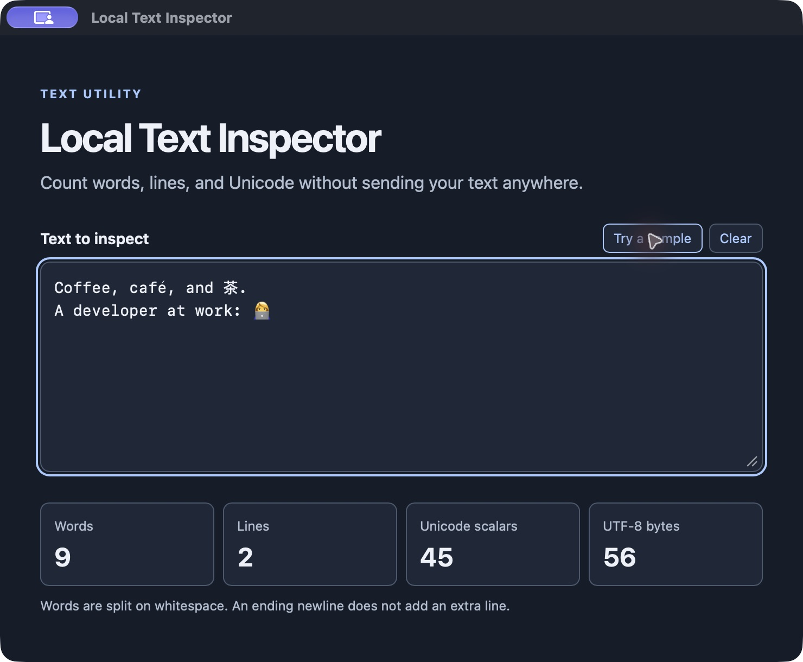
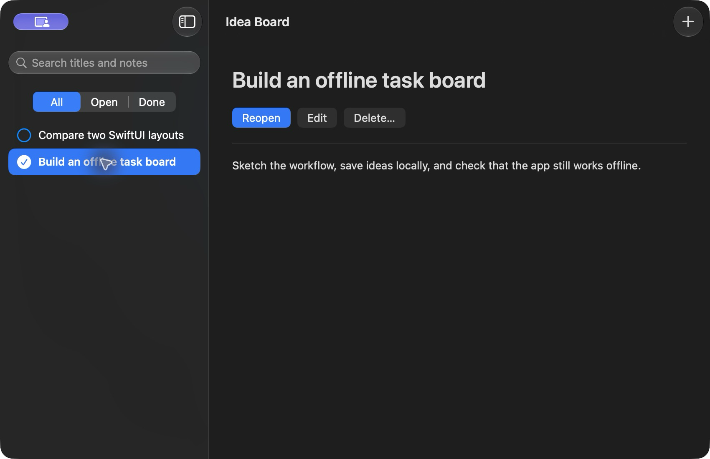

# Using Devline

The macOS app and CLI share the same local library. See the [README](README.md) for an overview and a first project.

## Install

Download the Apple Silicon DMG from [GitHub Releases](https://github.com/fpl0/devline/releases/latest), then drag **Devline** into **Applications**. macOS 14 or later is required. The DMG includes first-launch instructions for the ad hoc-signed build.

## Read and look up references

Open **Docset Library** and install the docsets you want. Use **⌘F** to search in Devline, or try `py:Path.read_text()` to search Python directly. The reader keeps code examples, tables, links, and available illustrations. Links to installed pages open in Devline.

Use **⇧⌘O** to search Contents and pin it beside the article, **⇧⌘R** for Focus Reading, and **⌥⌘F** to find text within an article. **⌘[** and **⌘]** navigate reading history. Use **⌘D** to save a reference and **⇧⌘B** to open Saved and Recent. The app remembers the current reference, scroll position, and reading layout between launches.

In **Settings → Lookup from Any App**, choose a global shortcut. The default **⌃⌥D** opens lookup and **⌃⌥⌘D** looks up selected text when Accessibility access is enabled. You can also select text and use **Services → Look Up in Devline**. [Visual Studio Code and Neovim integrations](integrations/README.md) open the selected symbol with the editor’s project context.

## Match documentation to a project

Open a project folder with **⌘O**. **Current Project** brings together its references, readiness, local services, and app controls. Use **Project References** in **Documentation** to see detected dependencies, chosen docset versions, and any mismatch. Devline reads supported manifests and lockfiles for Python, C# and .NET, Java, Ruby, Go, Rust, Elixir, Node.js, and Swift. Resolved framework versions take priority over manifest constraints. Pin choices stay in the local library and are shared with the CLI.

Return through **Toolbox → Recent Projects** or **File → Open Recent**. **Browse Project Docs** clears unrelated searches and opens the project's reference scope. A generated project's origin links back to its exact starter release; the starter's reference links use its included versions.

```sh
devline project --path ./service
devline docs search 'Path.read_text' --project ./service
devline project --path ./service pin fastapi@0.162.0+devline.1
devline project --path ./service unpin fastapi
```

An unscoped lookup inside a project uses compatible installed references. Use a docset prefix such as `go:`, an exact `--docset PACK[@VERSION]`, or `--stack all` to override that selection. Computed versions and unsupported constraints can require a manual pin.

### Prepare an existing project

Choose **Prepare Offline** while connected. Devline prepares the project's matching or pinned documentation, dependency closure, and configured image archives together. Opening a project starts preparation when needed; progress stays in the project screen, with logs in **Activity**. The final result covers every component and identifies anything Devline cannot prepare, such as a missing compiler. Preparing archives does not start services.

Dependency preparation uses a staged copy and tests it with external networking denied. Existing local dependencies are tried first. When needed, Devline prepares a managed `.devline-offline` cache; it records verification only after the checks pass. Your original source files, manifests, and lockfiles stay intact. Changes to the source, lockfiles, toolchain, or cache can require another check. An explicit `project run` command can still use the prepared dependencies during development.

```sh
devline project --path ./service prepare --background
devline --offline toolbox check --path ./service
devline --offline project --path ./service run -- python -m pytest -q
```

`devline toolbox prepare --path ./service` runs the same complete preparation. Add `--offline` to require local resources; missing downloads are reported rather than fetched. `project readiness` checks dependency evidence only, while `toolbox status` and `toolbox check` include references, toolchains, and services. Removing the original starter from the library does not invalidate an already created project.

Preparation supports conventional single-runtime projects using Go modules, Cargo, Python registry requirements or static project dependencies, Bundler, Maven, NuGet, Mix/Hex, npm with `package-lock.json`, or Swift packages with `Package.swift`. Swift packages can use external source dependencies: keep their versions locked in `Package.resolved`, and Devline prepares the source repositories in the project's managed cache for offline builds. The selected adapter checks its prerequisites. Install the matching toolchain and any reported native build tools first. Open independently locked projects at their individual roots.

### Edit and run a project

In **Current Project → Develop & Run**, choose **Open in Editor** or **Read Project Guide**, make your changes, then choose **Run Offline**. Devline starts configured services from their saved image archives and runs the app with prepared dependencies. It supplies the project's local service connection settings automatically. Internet access is blocked for the app; connections to local services remain available.

The panel shows **Starting** while the app builds or waits for its configured readiness check. **Open App** becomes available when the local web app is ready. Use **App Logs** to inspect output. **Stop App** stops the app process; services and their data stay available until you stop them separately in **Local Services**.

The CLI shares the same managed app process with Devline:

```sh
devline --offline project --path ./service start
devline project --path ./service app-status
devline project --path ./service logs --tail 100
devline project --path ./service stop
devline project --path ./service commands
```

Use `devline --offline project --path ./service run` to run the configured app in your terminal instead. An explicit command after `--` uses the same prepared dependencies and connection settings; it does not automatically start services. For example, `devline --offline project --path ./service run -- ./test-offline.sh` runs the project's tests.

A project's `devline.json` can declare its commands and local web address:

```json
{
  "schema_version": 1,
  "run": {
    "command": ["./run.sh"],
    "url": "http://127.0.0.1:5080",
    "health_path": "/health/ready"
  },
  "test": { "command": ["./test-offline.sh"] }
}
```

Commands are argument arrays and run from the project folder. Keep the app in the foreground so Devline can track and stop it. The optional `url` must use HTTP with a loopback address and an explicit port; configure the app to listen there. Devline supplies this address as `ASPNETCORE_URLS` for ASP.NET Core. The optional `health_path` must return HTTP 200 before **Open App** is enabled; without it, Devline checks that the port accepts connections. Omit both fields for command-line or native desktop apps.

Without `devline.json`, Devline looks for `run.sh`, then a .NET project in the selected folder. It also recognizes `test-offline.sh`. Other projects can add a configuration or run an explicit CLI command. Devline detects the required runtime on your Mac; it does not install or upgrade it.

## Build a desktop app

The **Tauri Desktop App** starter is a text inspector with a Rust command and a small HTML/CSS/JavaScript interface. Its Cargo dependencies and web assets are included. It needs Rust/Cargo and Apple’s native build tools; no Node.js installation or frontend server is required.

The **SwiftUI Idea Board** starter is a native Mac app with notes, search, local JSON persistence, and model tests. It uses the Swift compiler, macOS SDK, and Swift Testing from a locally installed Xcode 16 or later. Select Xcode in **Settings → Locations → Command Line Tools**, or set `DEVELOPER_DIR`. Devline discovers those tools with `xcrun`; it does not download or manage them.

```sh
devline prepare rust/tauri-desktop
devline prepare swift/swiftui-app
devline --offline new rust/tauri-desktop ./text-inspector
devline --offline new swift/swiftui-app ./idea-board
devline --offline project --path ./idea-board run -- ./run.sh
devline --offline docs search 'tauri:commands'
```

Both projects include `run.sh`, `build-app.sh`, and `test-offline.sh`. Build output stays under `target/` for Tauri and `.build/` for SwiftUI. The generated `.app` is signed locally for development. Tauri’s recipe refreshes compatible 2.x dependencies, vendors them, and verifies the result. The SwiftUI recipe rebuilds against the selected local SDK.





The desktop documentation includes an official Tauri snapshot and **The Swift Programming Language**.

### Prepare the SwiftUI SDK reference

In **Docset Library → From This Mac**, find **SwiftUI · Apple API Reference** and choose **Prepare from Xcode**. **Prepare Offline** in **Current Project** includes this import when the project needs it. The import reads the selected macOS SDK locally and works offline.

```sh
devline docs local
devline --offline docs install swiftui --background
devline --offline docs search 'swiftui:View'
```

Follow the import in **Activity** or with `devline jobs status JOB_ID --follow`. Search after the job succeeds. Use the same card or import command after selecting a newer Xcode SDK. The card shows **Refresh from Xcode** when the selected snapshot is already installed. Devline keeps earlier installed snapshots available for project pins.

The reference comes from public declarations and original documentation comments in Apple’s SwiftUI module and, where available, SwiftUICore. It includes the examples found in those comments. Some APIs have a declaration only. Apple Developer website tutorials, articles, and illustrations are outside the SDK snapshot. Devline stores the extracted content locally and excludes it from app releases, downloadable docsets, and portable exports. Prepare it separately on each Mac. [Apple’s SwiftUI reference](https://developer.apple.com/documentation/swiftui/)

## Use the terminal

In **Devline → Settings → Command Line**, choose **Install CLI** to link the bundled command at `~/.local/bin/devline`. Use **Copy PATH Command** if your current shell needs that directory on its PATH. For a source install, the packaging script also creates a launcher in `../bin`.

```sh
devline docs install go@1.27.3+devline.3
devline docs search 'go:http.Handler' --pick
devline docs show 'go:http.Handler'
devline docs save 'go:http.Handler'
devline docs saved --pick
devline docs recent
```

The CLI works with the app closed. With the default pager, the reader opens at the matching declaration when available. Set `DEVLINE_PAGER` or `PAGER` to choose a pager. Pipes and `--no-pager` use the stored article text. Use `--ids` with search for exact IDs or `--json` for structured output. Use `docs show --open` to open an article in Devline or `--link` to print its versioned local link.

The CLI accepts `--offline` for operations that must stay local. An empty search exits with status 4, and readiness checks that require preparation exit with status 3. Run `devline completions --help` for shell setup. The `devkit` compatibility command, `devkit://` links, and `DEVKIT_HOME` and `DEVKIT_CATALOG` still work.

## Prepare a starter for offline use

**App Starters** shows a starter’s available releases, contents, dependency versions, and verification. **Toolchains** detects the compilers, interpreters, and SDKs on this Mac. Install and upgrade those tools separately. **Offline Library** checks your selected docsets and starters, or the references and toolchains needed by your open project.

**Prepare Starter** installs its related docs and runs verification. **Verify Offline Now** reruns the installed starter’s test with external networking denied. Background work appears in **Activity** with progress, logs, and cancellation.

```sh
devline templates inspect go/chi-api@1.2.0
devline prepare go/chi-api@1.2.0 --background
devline jobs status JOB_ID --follow
devline jobs cancel JOB_ID
devline offline status --starter go/chi-api@1.2.0
devline new go/chi-api@1.2.0 ./status-api
```

Use the ID printed by `prepare` when following or cancelling a job. Generated projects include an offline test script. Creating a project prepares its selected documentation and required service archives, then verifies the generated files with external networking denied. `devline --offline new` requires those service archives to be present already. A recipe can refresh its supported upstream dependencies online and verify the new release offline before installing it.

The app shows creation progress and lets you cancel while it prepares downloads and verifies the project. Use `devline new STARTER@VERSION ./project --background` for the same durable job in the CLI, followed by `devline jobs status JOB_ID --follow` or `devline jobs cancel JOB_ID`. A cancelled attempt keeps completed library downloads for the next attempt.

```sh
devline templates build go/chi-api --refresh-deps --background
devline templates verify go/chi-api@1.2.0 --background
```

### Starter inventory

Each starter includes its local dependency closure and an offline test. Use `devline templates inspect STARTER@VERSION` for the exact packages and platform. Service kits exercise their SQLite workflows and client setup locally. Use the corresponding prepared infrastructure services when your app needs a live database, broker, cache, or object store.

- **Go** ships a Chi API, a PostgreSQL and Redis Taskboard, a service kit with SQLite, PostgreSQL, MySQL, Redis, RabbitMQ, NATS, S3 and JWT, and a file-index CLI.
- **Rust** ships an Axum API, a service kit with SQLite, PostgreSQL, MySQL, Redis, RabbitMQ, NATS, S3, HTTP and JWT, and a JSONL report CLI.
- **Python** ships a FastAPI API, a service kit with Psycopg, PyMySQL, SQLite, Redis, Pika, NATS, Boto3, JWT and HTTPX, and a DuckDB and HTTPX data automation CLI.
- **Ruby** ships a JSON CLI, a Sinatra service kit with Sequel, PostgreSQL, MySQL, SQLite, Redis, RabbitMQ, NATS, S3, JWT and Faraday, and a Thor and Rake task automation starter. The native Ruby service dependencies require Apple Command Line Tools and OpenSSL 3.
- **C# and .NET** ship an ASP.NET Core API with EF Core, SQLite, PostgreSQL, MySQL, Redis, RabbitMQ, S3 and JWT, and a hosted report worker.
- **Java** ships a Spring Boot API with SQLite, PostgreSQL and MySQL JDBC, Redis, RabbitMQ, S3 and JOSE, and a JSON file tool.
- **Elixir** ships a Phoenix API with Ecto SQL, Postgrex, MyXQL, SQLite, Redis, RabbitMQ, S3 and Joken, and an OTP report worker.
- **Node.js and TypeScript** ship a Fastify service kit with SQLite, PostgreSQL, MySQL, Redis, RabbitMQ, NATS, S3, JOSE and Zod, a React and Vite web app, and Playwright browser and API automation with bundled WebKit for Apple Silicon on macOS 26.5 or later.

### Transfer a library

Export exact docset and starter releases from **Offline Library**, then inspect and import the compressed bundle on another Mac. The destination needs its own toolchain and local verification for imported starters.

```sh
devline bundle export ./travel.devlinebundle \
  --doc go@1.27.3+devline.3 --doc chi@5.2.4+devline.1 --starter go/chi-api@1.2.0
devline bundle inspect ./travel.devlinebundle
devline bundle import ./travel.devlinebundle
```

Inspect unfamiliar bundles before trusting their executable starter files. The import requires `--trust-starters` for starters outside Devline’s bundled catalog.

## Prepare local services

Open **Infrastructure** to browse PostgreSQL, MySQL, RabbitMQ, Redis, MongoDB, NATS, Mailpit, Meilisearch, SeaweedFS S3, and Keycloak. Each release shows its image publisher, license, exact tag, platform digest, and offline runbook. **Download for Offline Use** saves a verified arm64 archive in Devline's image vault independently of Docker's cache. Install and start a compatible local Docker engine with Compose before using the vault to run services.

Choose services when creating a project, or use **Current Project → Add Services** later. Devline gives the stack exact release pins, loopback ports, local credentials, and dedicated data volumes. Adding a service preserves existing selections, credentials, ports, and data. The app then prepares the project's dependencies, documentation, and image archives together. Start, stop, and view service logs from the same workspace. Stopping keeps the project's data. **Toolbox** shows your local inventory, and **Offline Library** checks the selected docs, starters, and image archives.

Service networks disable outbound NAT and use local DNS settings by default while keeping their published ports reachable from your Mac. **Run Offline** separately denies the app process external networking. Custom Docker routing or engine configuration can change container connectivity; the app's network boundary does not rely on those Docker defaults.

A service image runs the server. A client library lets your code talk to that server. The service picker shows client suggestions for the project's runtime, including package versions, offline availability, and anything already included. Optional libraries start unchecked: select **Add … to project** only when you want Devline to add that dependency. Selecting an image alone does not change your code dependencies. Built-in capabilities and unsupported combinations are identified without offering an unsuitable package.

For example, the ASP.NET Core API starter already includes PostgreSQL and RabbitMQ clients. Select the two services when creating it, then open the project and choose **Run Offline**. Its notes app stores notes in PostgreSQL and processes them through RabbitMQ. The project guide explains the code, tests, and the SQLite fallback when no services are configured.

```sh
devline new dotnet/aspnet-api@1.2.0 ./notes \
  --service postgres@18.6 --service rabbitmq@4.3.7
devline --offline project --path ./notes start
```

For a starter that does not already declare a supported client, add an explicit selection such as `--client dotnet:postgres` to `devline new`. New client choices modify the project's dependency declarations and prepare their offline closure. Leave the flag out to keep the starter's dependencies unchanged.

To see suggestions for an existing project, use `devline infra clients ./project`; use `devline infra clients --stack dotnet` to browse without a project. You can add an image and its client together, or add a client to a project that already has its services:

```sh
devline infra clients ./service
devline infra add ./service --service postgres@18.6 --client dotnet:postgres
devline infra add ./service --client dotnet:rabbitmq
devline toolbox prepare --path ./service
```

An explicit client addition resolves dependencies in a staged copy, prepares their local vendor directory or cache, and verifies with external networking denied before publishing the changes. Use `--offline` to require locally available artifacts. Adding a service without `--client` only changes its service configuration; `toolbox prepare` saves the selected image archives and checks the complete project.

Add `--background` to `infra add` for a cancellable job. The app's **Add & Prepare** action shows this progress in the project, then prepares the matching docs and image archives after the additions succeed. Preferred ports are selected automatically when free; edit a port only when you need a specific value.

```sh
devline infra catalog
devline infra prepare postgres@18.6
devline infra prepare redis@8.10.1
devline prepare go/chi-taskboard@1.0.0
devline --offline new go/chi-taskboard@1.0.0 ./taskboard
devline --offline infra run ./taskboard
devline toolbox check --path ./taskboard
devline infra stop ./taskboard
```

The Taskboard starter uses PostgreSQL for persistence and Redis for caching. Its generated README includes the local app launch and test commands. Use `devline infra credentials ./taskboard` in a private terminal when you need the connection strings. For an existing project, readiness checks the selected local resources and reports whether its own dependencies were verified. Use `devline toolbox check --library-only --image postgres@18.6` to check an archive independently of a project.

### Transfer images

Use **Infrastructure → Transfer** or export selected images to a local file. Import verifies the archive against the catalog's exact image identity. Restore loads it into Docker without pulling from a registry.

```sh
devline infra export ./project-images.devlineimages --image postgres@18.6 --image redis@8.10.1
devline infra import ./project-images.devlineimages --inspect
devline infra import ./project-images.devlineimages
devline --offline infra restore postgres@18.6
```

The destination needs Docker, the project toolchains, and dependencies. Importing an image pin outside the known catalog requires explicit trust. Move service data and credentials separately. [Volume backup guide](data/help/infrastructure/portable-toolbox.md)

## Updates

Open **Updates** and choose **Check for Updates**. The list shows newer releases for the documentation, starters, and service images saved in your offline library. Choose **Update** for one item or **Update All** for the whole list. Devline keeps project pins and, by default, previous releases. Unfinished updates stay in the list with a **Retry** button. If a publisher check fails, open **Check Details**; updates already confirmed can still be applied.

To browse downloadable docsets, read release notes, or switch the active version, use **Docset Library → Manage Releases…**. Toolchain publisher results are in **Toolchains → Publisher Releases**. To check for a newer Devline app, use **App Updates and Downloads…** in the Devline menu or **App Updates** in Settings.

The **Documentation** tab downloads independently published snapshots. Devline checks archive size and SHA-256 and resumes interrupted downloads where the server supports it. The details show sources, coverage, and known omissions. You can roll back to an earlier installed release.

```sh
devline docs updates                 # cached channel status
devline docs updates check           # fetch the channel manifest
devline docs fetch go@1.27.3+devline.3 --background
devline docs rollback go@1.27.3+devline.2
devline updates check --background   # check all content sources
devline updates apply --background   # prepare checked content updates
devline updates apply template:go/chi-api # update or retry one item
devline --offline updates            # read saved status
```

Follow either background operation with `devline jobs status JOB_ID --follow`. Completed work is retained if another item fails, and the result identifies the remaining items. Retry after resolving the reported prerequisite. Updating library content does not rewrite projects, change their service pins, or start their containers.

Runtime updates open official installation pages. Devline 0.7.0 uses direct downloads: the app-update section and CLI link to the checked public release. Install or upgrade using the GitHub DMG. The signed Sparkle updater remains disabled in this build because no signed appcast is published. A future build can enable it only with its signing key and Ed25519-signed feed and archives. [Download Devline 0.7.0](https://github.com/fpl0/devline/releases/download/v0.7.0/Devline-macos-arm64.dmg)

Infrastructure also checks publishers for newer compatible images. `devline infra updates check` refreshes observations, and `devline infra update SERVICE` prepares the checked release. App updates can include newer catalog entries.

### Purge older releases

In **Settings → Local Library**, turn on **Keep only the latest version after updates** to purge older releases of an item when Devline installs its newest local version. The setting is off by default. Use **Purge Older Versions…** to clean existing docsets, starters, and image archives in one pass, regardless of the setting.

Cleanup applies to Devline’s local library. Each project keeps its exact pins and may need a purged release prepared again before it can work offline.

```sh
devline library retention                         # show the current setting
devline library retention --keep-latest true      # enable automatic cleanup
devline library retention --keep-latest false     # disable automatic cleanup
devline library purge                             # purge older local releases now
```

## Devline help and reference coverage

Select a service in **Infrastructure** and choose **Read Offline Reference**. Devline installs the bundled reference if needed and opens the publisher’s article. **Offline Reference Coverage** describes the bundled scope and its omissions. **Publisher Documentation** opens the service’s manual online.

The Infrastructure References pack covers all ten catalog services. It includes the complete PostgreSQL 18.6 HTML manual and redistributable publisher material for the other services. MySQL and MongoDB include upstream command-line and image references, with their full database manuals linked online. Redis includes command help for the pinned image and archived publisher guides. The pack records the source version, license, and scope for each service. [Infrastructure source inventory](data/docs/infrastructure/2026.11.07+devline.3/SOURCES.md)

```sh
devline --offline docs install infrastructure --version 2026.11.07+devline.3
devline --offline docs search JetStream --docset infrastructure@2026.11.07+devline.3
devline --offline docs show 'infrastructure@2026.11.07+devline.3/reference/postgres/index'
```

Use **Read Devline Guide** or `devline guide` for setup instructions specific to Devline. [Documentation policy](DOCUMENTATION-POLICY.md)

## Build and validate

Documentation ingestion tests use Pandoc. Install it with `brew install pandoc` before running the Python tests. It is not needed to use the app or build projects from its starters.

On Apple Silicon, use Xcode and its command-line tools, Rust/Cargo, and Python 3.

```sh
./scripts/package.sh --no-install
./scripts/create-dmg.sh
bash ./scripts/install.sh
cargo test --locked --manifest-path core/Cargo.toml
python3 -m unittest discover -s scripts -p 'test_*.py'
python3 scripts/check-doc-packs.py
python3 scripts/check-infrastructure.py
```

The build uses checked-in catalog snapshots and may download locked Rust dependencies and Sparkle. The app defaults to `~/Library/Application Support/DevKit`. Use `DEVKIT_HOME` or `--home` to isolate the library and `DEVKIT_CATALOG` or `--catalog` to select another catalog.

The bundled library includes 23 docsets and keeps earlier Go and Chi revisions for pinned projects. Its Node ecosystem references cover Node.js core APIs, TypeScript, Playwright, React, and Vite. The starter catalog spans nine runtimes. [Validation and coverage](UX-VALIDATION.md) · [Core protocol](CONTRACT.md) · [Third-party notices](THIRD_PARTY_NOTICES.md)

Documentation source versions and licenses are recorded in each pack’s `SOURCES.md`. Rebuild Markdown snapshots with Pandoc 3.13 and `scripts/fetch-docs.py`. `scripts/fetch-desktop-docs.py --help` describes the pinned inputs for rebuilding Tauri and Swift packs into a fresh staging directory. `scripts/doc-release.py` builds and verifies independently downloadable pack archives. [GitHub Actions](https://github.com/fpl0/devline/actions)
