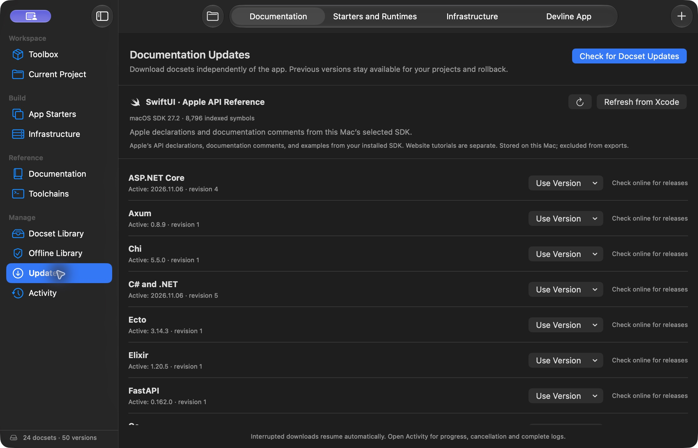

# Using Devline

The macOS app and CLI share the same local library. See the [README](README.md) for an overview and a first project.

## Install

Download the Apple Silicon DMG from [GitHub Releases](https://github.com/fpl0/devline/releases/latest), then drag **Devline** into **Applications**. macOS 14 or later is required. The DMG includes first-launch instructions for the ad hoc-signed build.

## Read and look up references

Open **Docset Library** and install the docsets you want. Use **⌘F** to search in Devline, or try `py:Path.read_text()` to search Python directly. The reader keeps code examples, tables, links, and available illustrations. Links to installed pages open in Devline.

Use **⇧⌘O** to search Contents and pin it beside the article, **⇧⌘R** for Focus Reading, and **⌥⌘F** to find text within an article. **⌘[** and **⌘]** navigate reading history. Use **⌘D** to save a reference and **⇧⌘B** to open Saved and Recent. The app remembers the current reference, scroll position, and reading layout between launches.

In **Settings → Lookup from Any App**, choose a global shortcut. The default **⌃⌥D** opens lookup and **⌃⌥⌘D** looks up selected text when Accessibility access is enabled. You can also select text and use **Services → Look Up in Devline**. [Visual Studio Code and Neovim integrations](integrations/README.md) open the selected symbol with the editor’s project context.

## Match documentation to a project

Open a project folder with **⌘O**. **Current Project** brings together its references, readiness, and local services. Use **Project References** in **Documentation** to see detected dependencies, chosen docset versions, and any mismatch. Devline reads supported manifests and lockfiles for Python, C# and .NET, Java, Ruby, Go, Rust, Elixir, Node.js, and Swift. Resolved framework versions take priority over manifest constraints. Pin choices stay in the local library and are shared with the CLI.

```sh
devline project --path ./service
devline docs search 'Path.read_text' --project ./service
devline project --path ./service pin fastapi@0.162.0+devline.1
devline project --path ./service unpin fastapi
```

An unscoped lookup inside a project uses compatible installed references. Use a docset prefix such as `go:`, an exact `--docset PACK[@VERSION]`, or `--stack all` to override that selection. Computed versions and unsupported constraints can require a manual pin.

### Prepare an existing project

Choose **Prepare Offline** while connected. Devline prepares a managed dependency cache for the selected project, then verifies a staged copy with external networking denied. It publishes `.devline-offline` and a local verification receipt after the checks pass. Your original source files, manifests, and lockfiles stay intact. Changes to the source, lockfiles, toolchain, or cache can require another check. An explicit `project run` command can still use the prepared dependencies during development.

```sh
devline project --path ./service prepare --background
devline --offline project --path ./service readiness
devline --offline project --path ./service run -- python -m pytest -q
```

Preparation supports conventional single-runtime projects using Go modules, Cargo, Python registry requirements or static project dependencies, Bundler, Maven, NuGet, Mix/Hex, npm with `package-lock.json`, or dependency-free Swift packages with `Package.swift`. Swift packages with external dependencies are currently rejected with an explanation; Devline does not mark them ready. The selected adapter checks its prerequisites. Install the matching toolchain and any reported native build tools first. Open independently locked projects at their individual roots.

## Build a desktop app

The **Tauri Desktop App** starter is a text inspector with a Rust command and a small HTML/CSS/JavaScript interface. Its Cargo dependencies and web assets are included. It needs Rust/Cargo and Apple’s native build tools; no Node.js installation or frontend server is required.

The **SwiftUI Idea Board** starter is a native Mac app with notes, search, local JSON persistence, and model tests. It uses the Swift compiler, macOS SDK, and Swift Testing from a locally installed Xcode 16 or later. Select Xcode in **Settings → Locations → Command Line Tools**, or set `DEVELOPER_DIR`. Devline discovers those tools with `xcrun`; it does not download or manage them.

```sh
devline prepare rust/tauri-desktop
devline prepare swift/swiftui-app
devline --offline new rust/tauri-desktop ./text-inspector
devline --offline new swift/swiftui-app ./idea-board
devline --offline project --path ./idea-board run -- ./run.sh
devline --offline docs search 'tauri:commands'
```

Both projects include `run.sh`, `build-app.sh`, and `test-offline.sh`. Build output stays under `target/` for Tauri and `.build/` for SwiftUI. The generated `.app` is signed locally for development. Tauri’s recipe refreshes compatible 2.x dependencies, vendors them, and verifies the result. The SwiftUI recipe rebuilds against the selected local SDK.


The desktop documentation includes an official Tauri snapshot and **The Swift Programming Language**.

### Prepare the SwiftUI SDK reference

In **Docset Library → From This Mac** or **Updates → Documentation**, find **SwiftUI · Apple API Reference** and choose **Prepare from Xcode**. If **Current Project** reports missing SwiftUI documentation, choose **Prepare SwiftUI Reference** there. The import reads the selected macOS SDK locally and works offline.

```sh
devline docs local
devline --offline docs install swiftui --background
devline --offline docs search 'swiftui:View'
```



Follow the import in **Activity** or with `devline jobs status JOB_ID --follow`. Search after the job succeeds. Use the same card or import command after selecting a newer Xcode SDK. The card shows **Refresh from Xcode** when the selected snapshot is already installed. Devline keeps earlier installed snapshots available for project pins.

The reference comes from public declarations and original documentation comments in Apple’s SwiftUI module and, where available, SwiftUICore. It includes the examples found in those comments. Some APIs have a declaration only. Apple Developer website tutorials, articles, and illustrations are outside the SDK snapshot. Devline stores the extracted content locally and excludes it from app releases, downloadable docsets, and portable exports. Prepare it separately on each Mac. [Apple’s SwiftUI reference](https://developer.apple.com/documentation/swiftui/)

## Use the terminal

In **Devline → Settings → Command Line**, choose **Install CLI** to link the bundled command at `~/.local/bin/devline`. Use **Copy PATH Command** if your current shell needs that directory on its PATH. For a source install, the packaging script also creates a launcher in `../bin`.

```sh
devline docs install go@1.27.3+devline.3
devline docs search 'go:http.Handler' --pick
devline docs show 'go:http.Handler'
devline docs save 'go:http.Handler'
devline docs saved --pick
devline docs recent
```

The CLI works with the app closed. With the default pager, the reader opens at the matching declaration when available. Set `DEVLINE_PAGER` or `PAGER` to choose a pager. Pipes and `--no-pager` use the stored article text. Use `--ids` with search for exact IDs or `--json` for structured output. Use `docs show --open` to open an article in Devline or `--link` to print its versioned local link.

The CLI accepts `--offline` for operations that must stay local. An empty search exits with status 4, and readiness checks that require preparation exit with status 3. Run `devline completions --help` for shell setup. The `devkit` compatibility command, `devkit://` links, and `DEVKIT_HOME` and `DEVKIT_CATALOG` still work.

## Prepare a starter for offline use

**App Starters** shows a starter’s available releases, contents, dependency versions, and verification. **Toolchains** detects the compilers, interpreters, and SDKs on this Mac. Install and upgrade those tools separately. **Offline Library** checks your selected docsets and starters, or the references and toolchains needed by your open project.

**Prepare Starter** installs its related docs and runs verification. **Verify Offline Now** reruns the installed starter’s test with external networking denied. Background work appears in **Activity** with progress, logs, and cancellation.

```sh
devline templates inspect go/chi-api@1.2.0
devline prepare go/chi-api@1.2.0 --background
devline jobs status JOB_ID --follow
devline jobs cancel JOB_ID
devline offline status --starter go/chi-api@1.2.0
devline new go/chi-api@1.2.0 ./status-api
```

Use the ID printed by `prepare` when following or cancelling a job. Generated projects include an offline test script. Creating a project prepares its selected documentation and required service archives, then verifies the generated files with external networking denied. `devline --offline new` requires those service archives to be present already. A recipe can refresh its supported upstream dependencies online and verify the new release offline before installing it.

```sh
devline templates build go/chi-api --refresh-deps --background
devline templates verify go/chi-api@1.2.0 --background
```

### Starter inventory

Each starter includes its local dependency closure and an offline test. Use `devline templates inspect STARTER@VERSION` for the exact packages and platform. Service kits exercise their SQLite workflows and client setup locally. Use the corresponding prepared infrastructure services when your app needs a live database, broker, cache, or object store.

- **Go** ships a Chi API, a PostgreSQL and Redis Taskboard, a service kit with SQLite, PostgreSQL, MySQL, Redis, RabbitMQ, NATS, S3 and JWT, and a file-index CLI.
- **Rust** ships an Axum API, a service kit with SQLite, PostgreSQL, MySQL, Redis, RabbitMQ, NATS, S3, HTTP and JWT, and a JSONL report CLI.
- **Python** ships a FastAPI API, a service kit with Psycopg, PyMySQL, SQLite, Redis, Pika, NATS, Boto3, JWT and HTTPX, and a DuckDB and HTTPX data automation CLI.
- **Ruby** ships a JSON CLI, a Sinatra service kit with Sequel, PostgreSQL, MySQL, SQLite, Redis, RabbitMQ, NATS, S3, JWT and Faraday, and a Thor and Rake task automation starter. The native Ruby service dependencies require Apple Command Line Tools and OpenSSL 3.
- **C# and .NET** ship an ASP.NET Core API with EF Core, SQLite, PostgreSQL, MySQL, Redis, RabbitMQ, S3 and JWT, and a hosted report worker.
- **Java** ships a Spring Boot API with SQLite, PostgreSQL and MySQL JDBC, Redis, RabbitMQ, S3 and JOSE, and a JSON file tool.
- **Elixir** ships a Phoenix API with Ecto SQL, Postgrex, MyXQL, SQLite, Redis, RabbitMQ, S3 and Joken, and an OTP report worker.
- **Node.js and TypeScript** ship a Fastify service kit with SQLite, PostgreSQL, MySQL, Redis, RabbitMQ, NATS, S3, JOSE and Zod, a React and Vite web app, and Playwright browser and API automation with bundled WebKit for Apple Silicon on macOS 26.5 or later.

### Transfer a library

Export exact docset and starter releases from **Offline Library**, then inspect and import the compressed bundle on another Mac. The destination needs its own toolchain and local verification for imported starters.

```sh
devline bundle export ./travel.devlinebundle \
  --doc go@1.27.3+devline.3 --doc chi@5.2.4+devline.1 --starter go/chi-api@1.2.0
devline bundle inspect ./travel.devlinebundle
devline bundle import ./travel.devlinebundle
```

Inspect unfamiliar bundles before trusting their executable starter files. The import requires `--trust-starters` for starters outside Devline’s bundled catalog.

## Prepare local services

Open **Infrastructure** to browse PostgreSQL, MySQL, RabbitMQ, Redis, MongoDB, NATS, Mailpit, Meilisearch, SeaweedFS S3, and Keycloak. Each release shows its image publisher, license, exact tag, platform digest, and offline runbook. **Download for Offline Use** saves a verified arm64 archive in Devline's image vault independently of Docker's cache. Install and start a compatible local Docker engine with Compose before using the vault to run services.

In **Current Project**, choose the services your project needs. Devline gives the stack exact release pins, loopback ports, local credentials, and dedicated data volumes. Start, stop, and view service logs from that workspace. Stopping keeps the project's data. **Toolbox** shows your local inventory, and **Offline Library** checks the selected docs, starters, and image archives.

```sh
devline infra catalog
devline infra prepare postgres@18.6
devline infra prepare redis@8.10.1
devline prepare go/chi-taskboard@1.0.0
devline --offline new go/chi-taskboard@1.0.0 ./taskboard
devline --offline infra run ./taskboard
devline toolbox check --path ./taskboard
devline infra stop ./taskboard
```

The Taskboard starter uses PostgreSQL for persistence and Redis for caching. Its generated README includes the local app launch and test commands. Use `devline infra credentials ./taskboard` in a private terminal when you need the connection strings. For an existing project, readiness checks the selected local resources and reports whether its own dependencies were verified. Use `devline toolbox check --library-only --image postgres@18.6` to check an archive independently of a project.

### Transfer images

Use **Infrastructure → Transfer** or export selected images to a local file. Import verifies the archive against the catalog's exact image identity. Restore loads it into Docker without pulling from a registry.

```sh
devline infra export ./project-images.devlineimages --image postgres@18.6 --image redis@8.10.1
devline infra import ./project-images.devlineimages --inspect
devline infra import ./project-images.devlineimages
devline --offline infra restore postgres@18.6
```

The destination needs Docker, the project toolchains, and dependencies. Importing an image pin outside the known catalog requires explicit trust. Move service data and credentials separately. [Volume backup guide](data/help/infrastructure/portable-toolbox.md)

## Updates

**Updates** shows documentation, starter, and runtime availability. **Documentation Updates** downloads independently published snapshots. Devline checks archive size and SHA-256, resumes interrupted downloads where the server supports it, and keeps installed versions for rollback and project pins. The details show sources, coverage, and known omissions.

```sh
devline docs updates                 # cached channel status
devline docs updates check           # fetch the channel manifest
devline docs fetch go@1.27.3+devline.3 --background
devline docs rollback go@1.27.3+devline.2
devline updates check                # upstream starter and runtime checks
```

Runtime updates open official installation pages. **Devline → Check for App Updates…** uses Sparkle. The app requires Ed25519-signed update archives and appcast feeds. Automatic checks are optional and start off. A signed appcast is unavailable for 0.5.0. Install or upgrade this release using the GitHub DMG. The CLI’s separate `updates` status can link to the public app release. [Download Devline 0.5.0](https://github.com/fpl0/devline/releases/download/v0.5.0/Devline-macos-arm64.dmg)

Infrastructure also checks publishers for newer compatible images. `devline infra updates check` refreshes observations, and `devline infra update SERVICE` prepares the checked release alongside its predecessor. App updates can include newer catalog entries. Existing project configurations retain their exact pins and archived releases.

## Devline help and reference coverage

Use **Read Devline Guide** in Infrastructure, or `devline guide`, for Devline’s own setup instructions. These guides are separate from official publisher references. The infrastructure reference pack currently includes five PostgreSQL pages and one SeaweedFS API guide. The service screen identifies the other offline reference gaps and links to each publisher’s documentation. [Documentation policy](DOCUMENTATION-POLICY.md)

## Build and validate

On Apple Silicon, use Xcode and its command-line tools, Rust/Cargo, and Python 3.

```sh
./scripts/package.sh --no-install
./scripts/create-dmg.sh
./scripts/install.sh
cargo test --locked --manifest-path core/Cargo.toml
python3 scripts/check-doc-packs.py
python3 scripts/check-infrastructure.py
```

The build uses checked-in catalog snapshots and may download locked Rust dependencies and Sparkle. The app defaults to `~/Library/Application Support/DevKit`. Use `DEVKIT_HOME` or `--home` to isolate the library and `DEVKIT_CATALOG` or `--catalog` to select another catalog.

The bundled library includes 23 docsets and keeps earlier Go and Chi revisions for pinned projects. Its Node ecosystem references cover Node.js core APIs, TypeScript, Playwright, React, and Vite. The starter catalog spans nine runtimes. [Validation and coverage](UX-VALIDATION.md) · [Core protocol](CONTRACT.md) · [Third-party notices](THIRD_PARTY_NOTICES.md)

Documentation source versions and licenses are recorded in each pack’s `SOURCES.md`. Rebuild Markdown snapshots with Pandoc 3.13 and `scripts/fetch-docs.py`. `scripts/fetch-desktop-docs.py --help` describes the pinned inputs for rebuilding Tauri and Swift packs into a fresh staging directory. `scripts/doc-release.py` builds and verifies independently downloadable pack archives. [GitHub Actions](https://github.com/fpl0/devline/actions)
